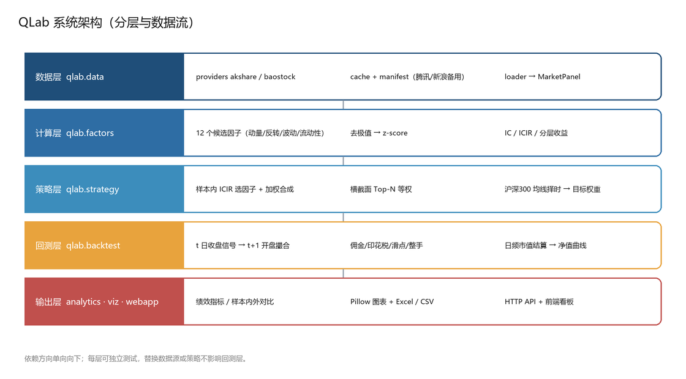
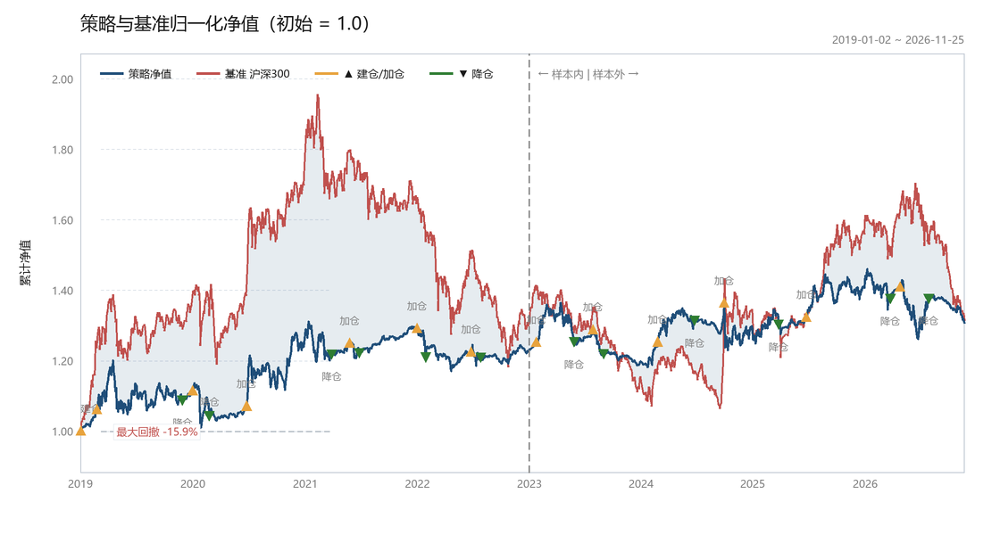
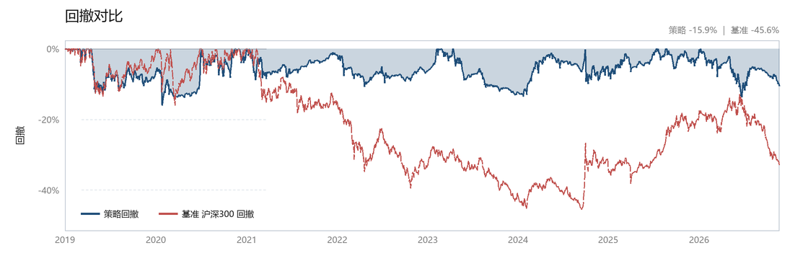
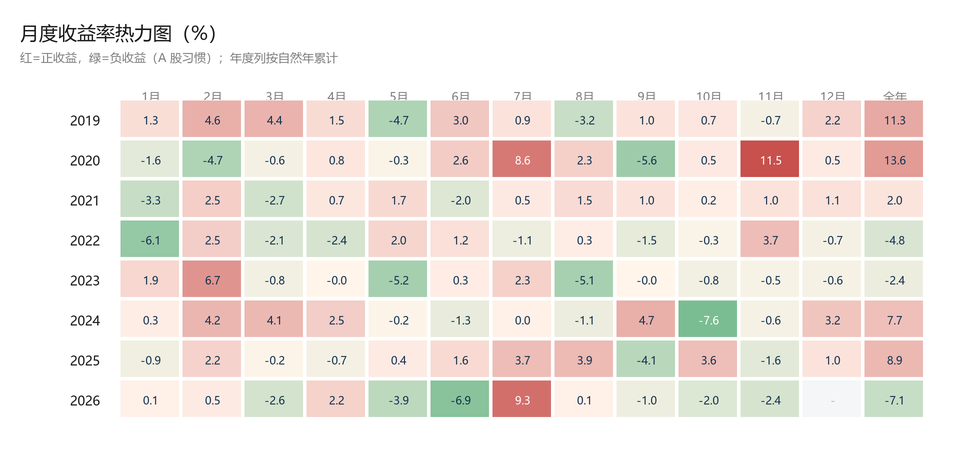
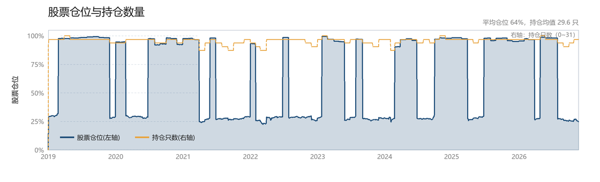
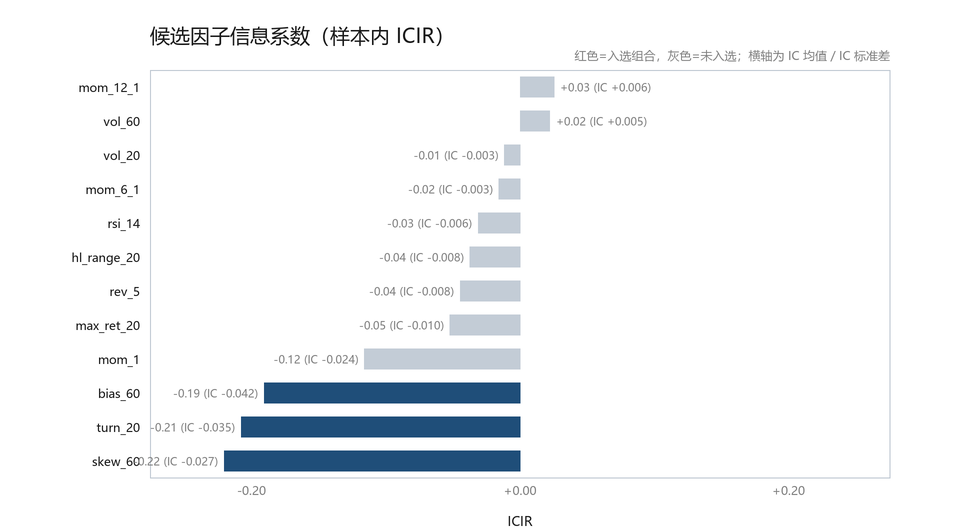

# QLab：A 股多因子选股与趋势择时量化交易系统

> **项目技术报告**

> 课程：量化交易　|　形式：小组项目（4 人）  
> 组别：L 组　|　组长：庄昊钊　|　组员：冯培智、庄昊钊、罗胜辉、甘洺宇  
> 回测区间：2019-01-02 ~ 2026-11-25  
> 股票池：148 只 A 股（市值前 300 名）  
> 代码仓库：GitHub（见提交邮件）　|　运行环境：Python 3.12

## 一、摘要

本项目实现了一个可真实运行的 A 股量化交易系统 QLab，覆盖数据接入、因子计算、策略信号、回测内核、绩效归因与可视化展示六个环节。策略采用「多因子横截面打分选股 + 沪深 300 趋势择时」的两层结构：每月末用 3 个因子合成综合得分，买入得分最高的 30 只股票等权持有；同时用沪深 300 收盘价与 120 日均线的关系控制总仓位（均线下方降至 30%）。

在 2019-01-02 ~ 2026-11-25 的回测区间内，策略累计收益 30.6%、年化 3.6%、最大回撤 -15.9%、夏普 0.23；同期沪深300累计 31.3%、最大回撤 -45.6%、夏普 0.21。年化超额收益 -0.1 个百分点（几何口径），信息比率 -0.08（算术口径；两者差异来自波动率拖累，见 5.2 注）。

按样本内（2019-2022）/样本外（2023 至今）切分后，策略年化收益分别为 5.5% 与 1.5%，夏普分别为 0.36 与 0.06。所有参数（因子选择、因子方向、择时窗口）只由样本内数据决定，样本外数据未参与任何选择。

## 二、数据来源与数据工程

### 2.1 数据来源

- 股票池：A 股实时快照（akshare 优先，接口限流时回退新浪列表接口），按抓取当日总市值降序取前 300 只，作为沪深 300 的大市值样本；剔除 ST 与退市标的，以及上市时间不足、拿不到 2017-09 之前历史行情的标的。
- 日线行情（主源）：akshare，覆盖 A 股日线与指数。取数优先走东方财富接口，请求过密被限流时改用新浪通道，单只标的失败不会中断整批。数据区间 2017-06-01 ~ 2026-11-25，共 2305 个交易日；成交量统一换算为「手」，价格取不复权。本次抓取有 294/306 只走新浪备用通道，逐只记录在 manifest 的 channel 字段中。
- 独立校验源：baostock。抽取 8 只标的把本地缓存与它的收盘价逐日比对：其中 6 只完全一致，其余最大绝对偏差为 0.001 元、0.01 元，属低价股/指数的一分钱取整，可以确认主源没有错位或缺日。复核命令：`python -m qlab check --sample 15`。腾讯与新浪接口保留，供回退使用。
- 基准：沪深 300 指数（sh000300）日收盘价，与个股同源、同为不含分红的价格序列，口径一致。
- 基准选择理由：本策略只买 A 股大市值股票，沪深 300 是同一域内最有代表性、且最常被用作 A 股业绩基准的宽基指数；同时补充中证 500 作为风格参照，用于说明策略收益并非单纯由大盘风格驱动。

### 2.2 复权口径的选择（关键工程决策）

本项目统一使用不复权（day）日线。三种口径各有代价：前复权序列会随每一次新分红整体重算，同一历史日期在不同时间取数得到的价格不同，回测时相当于让策略提前知道未来的分红，构成隐性前视；后复权价格随时间累积放大（贵州茅台 2026 年可达约 1 万元），按真实资金量下单时连一手都买不起，成交金额与滑点也失真；不复权则价格与真实市价一致，下单约束真实可执行。

不复权的代价是：个股除权除息日会形成价格跳空，绝对收益不含分红，A 股平均股息率约 2%，因此策略与基准的绝对收益都被低估约 2 个百分点/年。但本项目的基准是沪深 300 价格指数，同样不含分红，两者口径一致，超额收益的比较仍然公平。为控制除权跳空对因子的干扰，数据层另做了单日涨跌幅异常检查（|单日收益| > 25% 视为脏数据剔除）。

### 2.3 数据质量检查

行情数据在进入因子计算前要过一道质量闸门：统计每只标的的样本行数、首末交易日、缺失比例与单日涨跌幅。A 股有涨跌停制度（主板 ±10%、双创 ±20%、ST ±5%），单日收益理论上不会超过 25%，超过该阈值的基本只有两种情况：数据源本身错乱，或者除权除息在不复权序列上留下的跳空。系统统一按异常处理并剔除该标的，体检结果写入 `data_quality.csv`，避免个别的错误序列把组合净值带偏。

本次数据体检：206 只标的，合格 148 只；其余因上市时间不足或极值异常被剔除。

### 2.4 数据字典

| 字段 | 含义 | 示例 |
| --- | --- | ---: |
| date | 交易日 | 2024-01-02 |
| open | 开盘价（不复权，等于真实市价） | 1715.00 |
| high / low | 当日最高 / 最低价 | 1718.19 / 1678.10 |
| close | 收盘价 | 1685.01 |
| volume | 成交量（手） | 32156 |

## 三、系统架构与模块划分

系统按「数据层 → 计算层 → 策略层 → 回测层 → 输出层」单向依赖组织，每层只依赖下一层的抽象接口，因此替换数据源或替换策略都不需要改动回测内核。核心包约 5100 行，含脚本与测试约 6095 行，模块划分与职责如下表。


*图 1　QLab 系统架构与数据流*

| 模块 | 职责 |
| --- | --- |
| qlab.data | 数据接入：多数据源适配、本地缓存、质量检查、面板装配 |
| qlab.factors | 计算：12 个候选因子、去极值、标准化、IC/ICIR 分析 |
| qlab.strategy | 策略：样本内因子筛选、加权合成、Top-N 组合、择时 |
| qlab.backtest | 回测：t+1 开盘撮合、手续费/印花税/滑点、日频结算 |
| qlab.analytics | 输出：绩效指标、样本内外对比、Excel/Markdown 导出 |
| qlab.viz | 展示：Pillow 绘图（净值/回撤/热力图/因子 IC） |
| qlab.webapp | 展示：标准库 HTTP 服务 + 前端看板，支持在线重跑回测 |
| tests/ | 38 个单元测试：撮合时点、费用记账、指标公式、因子数学、权重约束、停牌处理 |

### 3.1 回测内核的三个关键约定

- 信号与成交严格分离：t 日收盘后用当日及历史数据计算目标权重，t+1 日开盘价撮合。单元测试用"跳空 10 倍"的构造行情验证了这一点——若误用收盘价成交，净值会放大 10 倍。
- 成本按 A 股实际规则计：佣金万 2.5（单笔最低 5 元）、卖出印花税（2023-08-28 前千 1、之后千 0.5）、单边滑点 5bp、按 100 股整手取整、现金不足时按比例缩减买单。
- 停牌与退市处理：当日无开盘价的标的不参与调仓、保留原持仓（不能按停牌前价格成交），估值沿用最近有效收盘价。

## 四、策略设计

### 4.1 整体思路

策略对应课程中的「多因子选股」与「择时」两类方法。多因子部分解决"买什么"：在横截面上用若干具有经济含义的因子给股票打分，买入综合得分最高的一篮子股票；择时部分解决"买多少"：用沪深 300 指数与 120 日均线的关系决定总仓位。两层结构的好处是：选股 alpha 与市场 beta 分离，回撤控制不依赖个股择时。

### 4.2 候选因子与筛选

候选池共 12 个因子，覆盖动量、反转、波动率、流动性、趋势与高阶矩等类别。筛选规则分两步：(1) 按样本内 ICIR 绝对值降序；(2) 贪心加入，若与已选因子截面相关性超过 0.75 则跳过，避免同质因子重复计权。下表给出全部候选因子的样本内 IC 检验结果与最终权重。

| 因子 | 含义 | IC 均值 | ICIR | t 值 | 入选 |
| --- | --- | ---: | ---: | ---: | --- |
| turn_20 | 20 日平均成交量 / 250 日均量（成交拥挤度代理） | -0.0351 | -0.212 | -1.66 | ✔ |
| skew_60 | 60 日收益偏度 | -0.0248 | -0.201 | -1.62 | ✔ |
| bias_60 | 收盘价相对 60 日均线偏离度 | -0.0418 | -0.192 | -1.54 | ✔ |
| mom_1 | 1 个月反转 | -0.0250 | -0.123 | -1.00 |  |
| max_ret_20 | 20 日最大单日涨幅（彩票偏好） | -0.0109 | -0.057 | -0.46 |  |
| hl_range_20 | 20 日平均振幅（高低价差/收盘） | -0.0097 | -0.045 | -0.36 |  |
| rev_5 | 5 日短期反转 | -0.0079 | -0.042 | -0.34 |  |
| rsi_14 | 14 日 RSI（超买反转） | -0.0063 | -0.032 | -0.26 |  |
| mom_12_1 | 12 个月动量（跳过最近 1 个月） | +0.0056 | +0.025 | +0.18 |  |
| vol_60 | 60 日已实现波动率 | +0.0055 | +0.025 | +0.20 |  |
| mom_6_1 | 6 个月动量（跳过最近 1 个月） | -0.0033 | -0.015 | -0.12 |  |
| vol_20 | 20 日已实现波动率（低波异象） | -0.0026 | -0.012 | -0.10 |  |

> 注：IC 为因子值与未来 21 个交易日收益的横截面 Spearman 秩相关，在样本内（2017-06 起，含因子预热段）的月度调仓日上采样；ICIR = IC 均值 / IC 标准差。

### 4.3 因子方向与加权

| 因子 | 含义 | IC 均值 | ICIR | 方向 | 权重 |
| --- | --- | ---: | ---: | --- | ---: |
| turn_20 | 20 日平均成交量 / 250 日均量（成交拥挤度代理） | -0.0351 | -0.212 | 反向 | 0.351 |
| skew_60 | 60 日收益偏度 | -0.0248 | -0.201 | 反向 | 0.332 |
| bias_60 | 收盘价相对 60 日均线偏离度 | -0.0418 | -0.192 | 反向 | 0.317 |

综合得分 = Σ 权重 × 方向 × 标准化因子值。方向取该因子样本内 IC 的符号：IC 为正说明"因子值越大、未来收益越高"，权重取 |ICIR| 归一化。每个调仓日再做一次横截面 z-score（先按 2% 双侧缩尾），并对单日缺失的因子按有效权重重新归一，避免停牌或新股导致得分失真。

### 4.4 组合构建与择时

- 调仓频率：每月最后一个交易日生成信号，次一交易日开盘调仓；首个回测日额外建仓一次。
- 持仓数量：综合得分前 30 只，等权；单票权重上限 8%（等权约 3.3%，本样本未触发该上限）。
- 择时规则：沪深 300 收盘价 > 120 日均线 → 满仓；否则仓位降至 30%。该规则只影响目标总仓位，不改变选股名单。
- 样本隔离：因子选择、方向、权重与时序参数全部只用 2023-01-01 之前的数据确定（2017-06 起，含因子滚动窗口的预热段）；2023 年之后的数据只用于样本外检验，不参与任何决策。

## 五、回测设置与结果

### 5.1 回测设置

| 项目 | 设置 |
| --- | --- |
| 回测区间 | 2019-01-02 ~ 2026-11-25 |
| 样本内 / 样本外 | 2019-01-01 ~ 2022-12-31 / 2023-01-01 ~ 2026-11-25 |
| 初始资金 | 1,000,000 元 |
| 股票池 | 148 只（市值前 300 名） |
| 基准 | 沪深300（价格指数） |
| 佣金 | 万 2.5，单笔最低 5 元，双边 |
| 印花税 | 卖出收取：2023-08-28 前 0.1%，之后 0.05% |
| 滑点 | 单边 0.05% |
| 无风险利率 | 1.5%（年化，用于夏普/索提诺） |
| 调仓 / 成交价 | 月末信号，次一交易日开盘价 |

### 5.2 核心指标

| 指标 | 全样本 策略 | 全样本 基准 | 样本内 策略 | 样本内 基准 | 样本外 策略 | 样本外 基准 |
| --- | ---: | ---: | ---: | ---: | ---: | ---: |
| 累计收益率 | 30.58% | 31.27% | 22.79% | 30.38% | 5.91% | 0.27% |
| 年化收益率 | 3.58% | 3.65% | 5.47% | 7.13% | 1.55% | 0.07% |
| 年化波动率 | 12.28% | 19.00% | 13.32% | 20.48% | 11.12% | 17.36% |
| 最大回撤 | -15.93% | -45.60% | -15.93% | -39.59% | -13.68% | -24.80% |
| 夏普比率 | 0.23 | 0.21 | 0.36 | 0.37 | 0.06 | 0.00 |
| 索提诺比率 | 0.22 | — | 0.34 | — | 0.06 | — |
| 卡玛比率 | 0.22 | — | 0.34 | — | 0.11 | — |
| 月胜率 | 55.32% | — | 61.70% | — | 47.83% | — |
| 超额收益(年化) | -0.07% | — | -1.65% | — | 1.48% | — |
| 信息比率 | -0.08 | — | -0.20 | — | 0.04 | — |
| Alpha(年化) | 1.11% | — | 1.22% | — | 0.61% | — |
| Beta | 0.45 | — | 0.49 | — | 0.39 | — |
| 年化换手率 | 9.2x | — | 8.7x | — | 9.7x | — |

> 注："全样本"为 2019-01 至今；"样本内""样本外"分别按上表切分后重新以区间首日归一计算。"年化超额"为策略与基准 CAGR 之差（几何口径），"信息比率"由日频主动收益的算术均值年化得到，两者相差约 1.1 个百分点，约等于 0.5×(σ基准²−σ策略²) 的波动率拖累差（策略 12.3% vs 基准 19.0%），并非计算错误；Alpha 为按 Beta 调整后的年化超额。

### 5.3 净值曲线与买卖点


*图 2　策略与基准归一化净值（初始 = 1.0），▲ 为建仓/加仓点，▼ 为降仓点，虚线为样本内外分界*

从净值曲线看：全样本策略累计 30.6%、年化 3.6%，基准（沪深 300）累计 31.3%、年化 3.6%。分区间看，样本内（2019-2022）策略年化 5.5%，跑输基准的 7.1%；样本外（2023 起）策略年化 1.5%，明显好于基准的 0.1%。全样本收益与基准基本持平，优势主要体现在回撤与夏普：最大回撤 -15.9%，明显小于基准的 -45.6%，主要因为择时在指数跌破 120 日均线时把仓位降到 30%。图中 ▲ 为建仓/加仓、▼ 为降仓，虚线为样本内外分界。


*图 3　回撤对比：策略（面积） vs 基准（虚线）*


*图 4　月度收益热力图（红色=正收益、绿色=负收益，符合 A 股习惯；最后一列为全年累计）*


*图 5　股票仓位与持仓只数*


*图 6　候选因子 ICIR（深蓝为入选组合的因子）*

## 六、样本内/样本外对比与超额收益来源

把区间切成两段是检验策略是否过拟合最直接的办法。样本内 2019-2022 包含了 2019-2020 的成长股行情与 2021-2022 的调整；样本外 2023-2026 是存量博弈、红利与大盘价值占优的市场。下表把两段并排。

| 区间 | 年化收益 | 基准年化 | 年化超额 | 最大回撤 | 夏普 | 信息比率 | Beta |
| --- | ---: | ---: | ---: | ---: | ---: | ---: | ---: |
| 样本内 | 5.5% | 7.1% | -1.7% | -15.9% | 0.36 | -0.20 | 0.49 |
| 样本外 | 1.5% | 0.1% | 1.5% | -13.7% | 0.06 | 0.04 | 0.39 |

样本内年化超额 -1.7%，样本外 1.5%，样本外反而更高 3.1 个百分点。这说明超额并非只存在于样本内，但也可能与 2023 年后红利/大盘价值风格和因子的暴露方向相契合，不宜过度解读。样本外 Beta 为 0.39，择时把市场暴露压低了不少，收益更多来自选股而不是大盘上涨。

### 6.1 超额收益从哪里来

- 选股 alpha：入选因子按其样本内 IC 符号调整方向后合成综合得分，得分靠前的组合在下一期具有横截面区分度（见 4.2/4.3 的 IC 与 ICIR），但幅度有限：样本内年化超额为 -1.7%，说明这部分 alpha 并不稳定。
- 择时的仓位管理：关闭择时后年化收益由 3.6% 升到 14.8%、夏普由 0.23 升到 0.78，只有最大回撤由 -15.9% 扩大到 -23.8%。也就是说，本样本上择时只在回撤维度占优，风险调整后收益反而更低；它是按回撤预算做的取舍，不应表述为收益增强。
- 成本可控：月频调仓 + 30 只持仓，年化双边换手约 9.2 倍；按成交表实测，交易成本（佣金+印花税+滑点）约 1.10%/年，成本前毛超额约 1.0%/年。
- 幸存者偏差（负面因素）：股票池按 2026 年市值取前 300，天然只包含活到今天的赢家，这部分会让超额收益被高估，是本文最需要说明的局限。

### 6.2 风格参照：中证 500

为判断策略收益是否只是大盘风格，另取中证 500 作为中小盘风格参照。策略、沪深 300 与中证 500 使用同一区间、同为价格指数口径。

| 指数/策略 | 累计收益率 | 年化收益率 | 最大回撤 | 夏普比率 |
| --- | ---: | ---: | ---: | ---: |
| 策略 | 30.6% | 3.6% | -15.9% | 0.23 |
| 沪深300（基准） | 31.3% | 3.6% | -45.6% | 0.21 |
| 中证500 | 42.6% | 4.8% | -41.8% | 0.25 |

中证500 同期累计 42.6%、年化 4.8%、最大回撤 -41.8%、夏普 0.25；策略年化 3.6%、最大回撤 -15.9%。策略收益低于中证 500，但回撤明显更小，说明组合的风险暴露与两个宽基指数都不同，收益并非单纯来自某个风格 beta；2023 年后红利/大盘价值风格对结果的贡献仍需保留。

## 七、参数敏感性与消融实验

为判断结论是否依赖某一组特定参数，逐项改动配置并重跑全样本回测。除被改动的那一项外，其余设置完全一致。

| 配置 | 年化收益率 | 最大回撤 | 夏普比率 | 卡玛比率 | 年化超额 | 年化换手率 | 备注 |
| --- | ---: | ---: | ---: | ---: | ---: | ---: | --- |
| 主策略（Top30 + ICIR加权 + 择时） | 3.58% | -15.93% | 0.23 | 0.22 | -0.07% | 920.18% | — |
| 关闭择时 | 14.83% | -23.80% | 0.78 | 0.62 | 11.19% | 1269.15% | — |
| 因子等权（重新选因子） | 4.03% | -15.37% | 0.26 | 0.26 | 0.38% | 922.18% | — |
| 持仓 20 只 | 3.99% | -15.84% | 0.25 | 0.25 | 0.35% | 1002.92% | — |
| 持仓 50 只 | 3.57% | -15.71% | 0.23 | 0.23 | -0.07% | 763.85% | — |
| 季度调仓 | 5.98% | -19.73% | 0.40 | 0.30 | 2.34% | 469.55% | — |
| 择时 MA60 | 6.56% | -19.32% | 0.46 | 0.34 | 2.92% | 913.64% | — |
| 择时 MA250 | 6.70% | -13.23% | 0.44 | 0.51 | 3.05% | 890.37% | — |
| 择时低仓位 0% | -0.97% | -28.04% | -0.15 | -0.03 | -4.62% | 783.08% | — |
| 择时低仓位 50% | 6.84% | -14.52% | 0.45 | 0.47 | 3.19% | 1021.23% | — |

几点观察：(1) 关闭择时后年化收益 14.8%、最大回撤 -23.8%、夏普 0.78，主策略为 3.6% / -15.9% / 0.23；关闭择时在收益与夏普上更优、只在回撤上更差，说明本样本上择时不是收益增强项，而是按回撤预算做的仓位约束；(2) 持仓由 20 只增至 50 只，年化收益 4.0% → 3.6%、最大回撤 -15.8% → -15.7%，本样本上集中持仓的收益弹性更大，分散化并没有自动带来更高收益；(3) 季度调仓年化换手降至 4.7 倍、年化收益 6.0%，说明月频调仓捕捉到的短周期信号更多，但也要付出更高的交易成本；(4) 择时参数上，均线窗口改为 60/250 日年化分别为 6.6%/6.7%，低仓位改为清仓/50% 分别为 -1.0%/6.8%，说明结论对择时参数并不稳定，120 日/30% 是按回撤预算选定的参数，并非收益最优。

## 八、已知局限与改进方向

- 幸存者偏差：股票池用当前市值排序，未使用历史成分股，会高估收益。改进：接入沪深 300 历史成分股（按生效日期滚动）或全市场退市样本。
- 分红口径：个股与基准都用不含分红的价格序列（个股不复权、基准为沪深 300 价格指数），两边口径一致，超额收益的比较是公平的；代价是绝对收益被低估约 2 个百分点/年。改进：个股改用后复权、基准改用沪深 300 全收益指数，可得到含分红的绝对收益。
- 因子维度有限：目前只有量价因子，缺少基本面（估值、盈利、成长）与分析师预期数据，无法做真正的多维度多因子模型。
- 未考虑冲击成本与容量：组合初始资金为 100 万元，复制时先受 100 股整手约束；受此限制，个别高价股（如贵州茅台，一手约 15.7 万元）在小资金下无法买入，实际持仓为 27–30 只而非严格 30 只。若资金量放大，停牌与涨跌停导致的无法成交比例会上升。
- 未做行业中性：组合可能在某些行业上过度集中。改进：加入行业哑变量做中性化。

## 九、AI 辅助说明与复现步骤

按课程要求，如实说明 AI 工具的使用范围：本项目的工程骨架、数据适配器、回测引擎、因子库、指标与绘图模块由 AI 编程助手（DeepSeek Harness）在提示词指导下生成，并由小组成员逐行阅读、运行验证与修改；策略思路（多因子 + 均线择时的两层结构）、因子方向的经济学解释、样本内/外切分方式与成本假设由小组成员确定，组员可对上述任何设计选择答辩。AI 生成部分均在本仓库中可追溯（提交记录 + 本文档说明），核心逻辑不依赖任何第三方回测框架，全部为自行实现。

### 9.1 复现步骤

1. 安装依赖：`pip install -r requirements.txt`（Python 3.12）
2. 抓取行情：`python scripts/download_data.py`（300 只约 10–20 分钟，接口限流会自动补抓）
3. 跑回测：`python scripts/run_backtest.py`（输出指标、图表、参数敏感性实验）
4. 启动看板：`python -m qlab web`，浏览器打开 http://127.0.0.1:8000 可在线改参数重跑
5. 生成报告：`python -m qlab report`（即本文档）
6. 运行测试：`python -m unittest discover -s tests`（38 个用例）

### 9.2 目录结构

```text
quant/
├── qlab/                  # 主包
│   ├── data/              # 数据层：providers / cache / loader / quality
│   ├── factors/           # 计算层：library / preprocessing / analysis
│   ├── strategy/          # 策略层：multifactor / timing
│   ├── backtest/          # 回测层：engine / broker
│   ├── analytics/         # 指标与导出：metrics / report
│   ├── viz/               # 绘图：chart / figures
│   ├── webapp/            # Web 看板：server + static
│   ├── config.py          # 全局参数
│   └── cli.py             # 命令行入口
├── scripts/               # 数据抓取 / 回测流水线
├── tests/                 # 单元测试
├── data/raw/              # 行情缓存（CSV + manifest）
├── output/                # 图表、指标表、报告
├── README.md
└── requirements.txt
```

<!-- 由 项目技术报告.docx 自动转换生成；图片位于 media/ -->
